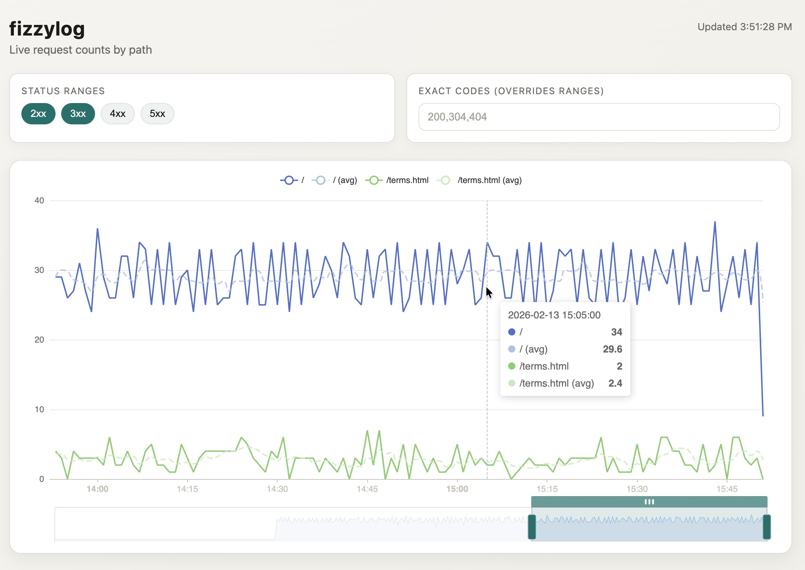

# fizzylog

**Light and refreshing web traffic visualization for lab environments.**

fizzylog is a small, self-contained tool for watching web traffic *bubble up*
during demos and hands-on labs. It tails an NGINX access log, aggregates
requests over time, and renders a clean, interactive time-series line chart.

It's designed to be easy to run and understand.



## What it does

- Tails an NGINX access log in real time
- Aggregates request counts into time buckets
- Stores compact rollups in SQLite
- Serves a simple API via FastAPI
- Displays an interactive line chart using [Apache ECharts](https://echarts.apache.org/)
- Filters by status ranges (2xx/3xx/4xx/5xx) or exact codes
- Supports zooming and live updates

You configure the exact paths you want to visualize (for example `/` and
`/terms.html`), and fizzylog shows how traffic to those pages changes over
time.

## What it's for

- Instructor-led training labs
- Demo environments
- Synthetic traffic experiments
- Quick visual feedback during presentations

## Design principles

- **Lightweight** - minimal dependencies, no build step for the UI
- **Ephemeral** - optimized for short-lived environments
- **Focused** - paths and status codes only

## Implementation assumptions

- There is some other web service generating NGINX access logs
- The backend has filesystem access to read those NGINX access logs
- The frontend can make HTTP GET requests to the backend API URL.

## Quick start

Requires Python 3 with `venv`. Start from the repository root; step 1 changes
into `backend/`, and the remaining commands run from there.

### 1. Install the backend

```sh
cd backend
python3 -m venv venv
. venv/bin/activate
pip install -r requirements.txt
```

### 2. Create a local config

From `backend/`, copy `config.example.yml` and point the log and SQLite paths
somewhere writable. `log.path` and `paths.include_exact` are required;
everything else has defaults.

```sh
mkdir -p /tmp/fizzylog
touch /tmp/fizzylog/access.log
sed -e 's#/var/log/nginx/access.log#/tmp/fizzylog/access.log#' \
    -e 's#/var/lib/fizzylog/rollups.sqlite#/tmp/fizzylog/rollups.sqlite#' \
    ../config.example.yml > /tmp/fizzylog/config.yml
```

To watch a real NGINX log instead, set `log.path` to it (for example
`/var/log/nginx/access.log`) and make sure your user can read it.

### 3. Run the service

From `backend/` with the virtualenv active:

```sh
python -m fizzylog.main --config /tmp/fizzylog/config.yml
```

The API listens on `127.0.0.1:<api.port>` (default `8081`). The SQLite file
and its directory are created automatically.

### 4. Generate traffic and check the API

fizzylog starts reading at the *end* of the log, so only lines written after
startup are counted. In another terminal, append a line in NGINX combined
format for one of the configured paths:

```sh
echo "127.0.0.1 - - [$(LC_ALL=C date -u +'%d/%b/%Y:%H:%M:%S +0000')] \"GET / HTTP/1.1\" 200 612 \"-\" \"curl/8.0\"" \
  >> /tmp/fizzylog/access.log

curl http://127.0.0.1:8081/api/v1/health
curl http://127.0.0.1:8081/api/v1/series
```

`/health` should report `"tailing": true` and a recent `last_ingest_utc`.
Rollups are flushed every `ingest.flush_seconds` (default 2s).

### 5. View the UI

The frontend in `frontend/` is static and calls `/api/v1/...` on the same
origin, so it must be served by a web server that also proxies `/api/` to the
backend. Use `packaging/nginx.conf` as a template: it serves the UI from
`/var/www/fizzylog` on port 81 and proxies `/api/` to `127.0.0.1:8081`. For
a full VM install (systemd unit, NGINX site, virtualenv), see
`packaging/setup_vm.sh`.

### Run the tests

`pytest` is not in `requirements.txt`; from `backend/`, install it into the same
virtualenv:

```sh
. venv/bin/activate
pip install pytest
python -m pytest tests/
```

Run a single file or test with `python -m pytest tests/test_paths.py` or
`python -m pytest tests/test_paths.py::<test_name>`.

## Configuration

All settings are declared in YAML. A fully documented template is included at
`config.example.yml`.

Key defaults:

- Access log: `/var/log/nginx/access.log`
- SQLite DB: `/var/lib/fizzylog/rollups.sqlite`
- FastAPI: `127.0.0.1:8081` (configurable)
- UI refresh: every 2 seconds
- Default status filter: `2xx+3xx`

## API

- `GET /api/v1/meta` - configuration defaults for the UI
- `GET /api/v1/series` - chart buckets and series data
- `GET /api/v1/health` - liveness and ingest status

## Packaging helpers

- `packaging/fizzylog.service` - systemd unit template
- `packaging/nginx.conf` - nginx site template
- `packaging/setup_vm.sh` - root-run setup script for Ubuntu-based VMs

## PAQ

### Why doesn't the frontend use web framework, TypeScript, or a bundler?

As this app targets instructional and demonstration environments, the code to
be easy to understand and modify withhout specialized knowledge.

Plus, you can easily see the JavaScript, HTML, and CSS in Web inspectors.

*Plus*, no build step. You can even edit the files in-place in a live
environment.

### Can I serve my demo app and the fizzylog frontend with the same NGINX instance?

Yes. You can even store fizzylog's own access and error logs under a different
filename so it doesn't interfere with the logs of the app you're trying to
visualize.

See `packaging/nginx.conf` for an example of how to set this up.

### What kind of security considerations are there?

None.

## Status

This project is under active development. The API, configuration, and UI are
intentionally small and subject to change before the first formal release.
